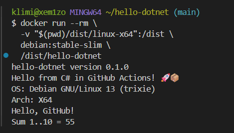

# hello-dotnet

Учебный проект с CI/CD на GitHub Actions для **C#/.NET CLI** с публикацией бинарников в **GitHub Releases**.

## 📌 Цель работы

Научиться автоматически собирать **self-contained** бинарники .NET CLI под **5 платформ** (Linux, macOS, Windows — на двух архитектурах) и публиковать их в GitHub Releases при push тега `v*`.

## 🎯 Что делает CI/CD

**Job `test`** — запускается при любом push:
- `dotnet format --verify-no-changes` — проверка форматирования
- `dotnet build` — сборка
- `dotnet test` — xUnit-тесты

**Job `release`** — запускается **только при push тега `v*`**:
- Матричная сборка под 5 платформ через `-r <RID>` (**cross-compilation с одного runner'а**):
  - `linux-x64`
  - `linux-arm64`
  - `win-x64`
  - `osx-x64`
  - `osx-arm64`
- `--self-contained true` + `PublishSingleFile` — один файл, .NET у пользователя не нужен
- Публикация файлов в **GitHub Release**

## 📂 Структура проекта

```
hello-dotnet/
├── .github/workflows/ci.yml
├── src/
│   ├── HelloDotnet.csproj
│   ├── Greeting.cs
│   └── Program.cs
├── tests/
│   ├── HelloDotnet.Tests.csproj
│   └── GreetingTests.cs
├── .gitignore
└── README.md
```

## 🟦 Основной код

**`src/Greeting.cs`:**
```csharp
namespace HelloDotnet;

public static class Greeting
{
    public static string Greet(string name) => $"Hello, {name}!";

    public static int SumRange(int from, int to)
    {
        int sum = 0;
        for (int i = from; i <= to; i++) sum += i;
        return sum;
    }
}
```

## 🚀 Создание релиза

```bash
git tag v0.1.0
git push origin v0.1.0
```

Workflow автоматически:
1. Прогонит формат-чек, сборку и тесты
2. Соберёт 5 бинарников параллельно (один runner — все платформы)
3. Создаст GitHub Release `v0.1.0` с прикреплёнными файлами

## 📥 Скачивание и запуск бинарника

### Windows (PowerShell)

```powershell
Invoke-WebRequest `
  -Uri "https://github.com/xem1zo/hello-dotnet/releases/download/v0.1.0/hello-dotnet-windows-x64.exe" `
  -OutFile "hello-dotnet.exe"

.\hello-dotnet.exe
```

### Linux / macOS

```bash
wget https://github.com/xem1zo/hello-dotnet/releases/download/v0.1.0/hello-dotnet-linux-x64 -O hello-dotnet
chmod +x hello-dotnet
./hello-dotnet
```

Ожидаемый вывод:
```
hello-dotnet version 0.1.0
Hello from C# in GitHub Actions! 🚀📦
OS: Linux 6.5.0-27-generic
Arch: X64
Hello, GitHub!
Sum 1..10 = 55
```

> 💡 **Первая строка** — `version 0.1.0` — версия из `<Version>` в `.csproj`, вшитая в бинарник при сборке.

## 📸 Результат запуска



## ✅ Результат

- **Job `test`** — зелёный при каждом push в `main`
- **Job `release`** — запускается по тегу `v*`, создаёт Release с 5 бинарниками

**Actions:** https://github.com/xem1zo/hello-dotnet/actions  
**Releases:** https://github.com/xem1zo/hello-dotnet/releases

## 📝 Вывод

Освоил:
- .NET CLI: `dotnet build`, `dotnet test`, `dotnet publish`, `dotnet format`
- xUnit — тесты в .NET
- **Cross-compilation** — один runner собирает под 5 платформ через `-r <RID>`
- **Runtime Identifiers**: `linux-x64`, `win-x64`, `osx-arm64`
- **Self-contained + PublishSingleFile** — один файл, .NET у пользователя не нужен
- Матричные сборки: 5 бинарников с одного runner'а
- Публикацию через `softprops/action-gh-release@v2`
- Семантическое версионирование (теги `v0.1.0`, `v0.2.0`)

## 🔑 Ключевое отличие от Python

| Аспект | **Python** (PyInstaller) | **.NET** |
|---|---|---|
| Cross-compilation | ❌ Нет | ✅ **Есть** (`-r <RID>`) |
| Runner'ов в матрице | 3 (по одному на ОС) | **1** (собирает под все платформы) |
| Размер бинарника | ~10-15 МБ | ~70 МБ (внутри .NET runtime) |
| Версия в файлах | 2 файла (`pyproject.toml`, `__init__.py`) | **1 файл** (`.csproj`) |

**.NET ближе к Go и Rust**, чем к Python: cross-compilation из коробки.